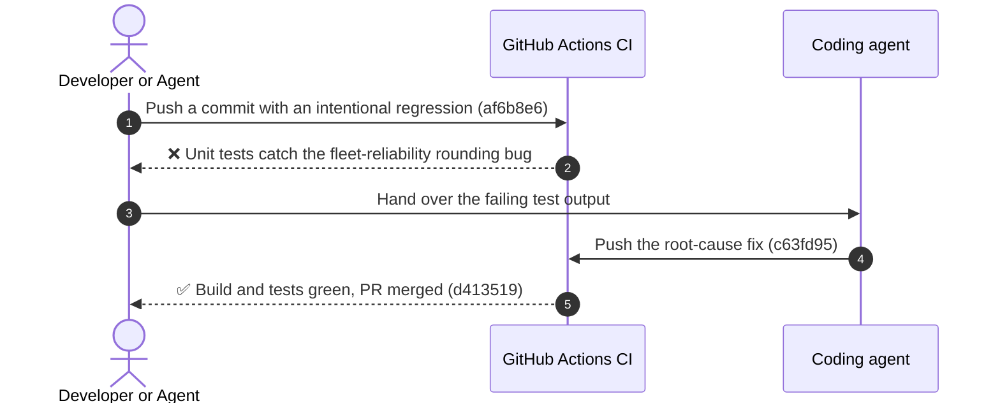

# ⚡ AgentPulse — Autonomous AI Agent Verification & Self-Healing Ops

[](https://testsprite.com)
[](https://agentpulse-pi.vercel.app)
[](LICENSE)
[](https://nextjs.org)
[](https://tailwindcss.com)

> Built for **TestSprite Hackathon Season 4** (Project Track & Continuous Verification Showcase).  
> **Live Production**: [https://agentpulse-pi.vercel.app](https://agentpulse-pi.vercel.app)  
> **Author**: Naufal ([@naufalfx805-source](https://github.com/naufalfx805-source)) • **Discord**: `@npall_805` • **Contact**: `naufalfx805@gmail.com`

---

## 🌟 Overview

**AgentPulse** is a mission-control observability and autonomous verification platform designed for developers building with modern AI agents (Antigravity, Claude Code, Codex, Cursor).

As AI agents write and deploy code in production, traditional manual QA is a bottleneck. AgentPulse pairs continuous telemetry with **TestSprite 3.0** autonomous testing to establish **"The Self-Healing Loop"**: every pull request gets its own Vercel preview, and the TestSprite GitHub App runs the project's end-to-end suite against that preview. When a regression is caught, the check fails and blocks the merge, the failure report goes back to the coding agent to fix the root cause, and the check reruns on its own.

---

## 🚀 Key Features

### 1. Fleet Reliability Observability
- Real-time Fleet Success Rate (98.6%), Mean Time to Remediation (MTTR: 42s), and Flakiness Index tracking.
- Live event stream showing agent dispatches, assertion checks, and automated self-healing events.

### 2. Multi-Step Pipeline Studio
- Interactive visual DAG for agent verification workflows (Prompt synthesis &rarr; Headed E2E test &rarr; AST diff check &rarr; Telemetry emission).
- Hard guardrails: Token allocation budget boundaries and timeout bounds matching TestSprite CLI standards.

### 3. TestSprite 3.0 Scenario Repository
- Comprehensive test scenario catalog (E2E, API contracts, Security guards, Regressions).
- Interactive scenario creator with real-time client-side schema validation.

### 4. Chaos & Synthetic Webhook Simulator
- Simulate GitHub Actions / TestSprite webhook events (`pull_request`, `deployment`, `testsprite_check`).
- Chaos injection knobs: Artificial latency (+0 to 2500ms), simulated 429 rate limits, and flaky network drops.

### 5. The TestSprite Self-Healing Loop Inspector
- Interactive walkthrough of the official 4-step Hackathon Season 4 loop:
  1. **Write (Maker)**: Agent pushes initial feature commit.
  2. **Test (Checker)**: TestSprite check fires on PR and catches regression.
  3. **Fix (Maker)**: Agent ingests failure bundle & commits root cause patch.
  4. **Test Again (Checker)**: TestSprite automatically reruns & PR turns GREEN!

---

## 🧪 What the Test Suite Covers

The end-to-end suite lives in the TestSprite 3.0 web portal (project `agentpulse-pi`). It was generated from the live app at https://agentpulse-pi.vercel.app and has **37 test cases across 5 use cases**:

| Use case | Cases | What it verifies |
|:---|:---:|:---|
| **Fleet Overview** (`FLE-001`–`FLE-005`) | 5 | Fleet health KPIs render; the overview links through to the pipeline workflow, the self-healing loop, monitored pipelines and live verification activity. |
| **Pipeline Studio** (`PIP-001`–`PIP-006`) | 6 | Running the default verification pipeline, the execution DAG, guardrail configuration, switching pipeline presets, remediation on failure, and the telemetry summary. |
| **Test Scenarios** (`SCE-001`–`SCE-014`) | 14 | The scenario repository: browsing, filtering by category, opening a scenario, the new-scenario flow, running a pipeline from the studio, policy and guardrail review, and navigation to the loop and fleet views. `SCE-011`–`SCE-014` cover input validation in the new-scenario form: expected status codes outside 100–599, or empty, are rejected, and target paths are trimmed. |
| **Self-Healing Verification Loop** (`LOO-001`–`LOO-006`) | 6 | The loop overview and each stage (write, test, fix, test again), ending with the loop closing on a pushed commit. |
| **Chaos Testing & Webhook Simulation** (`CHA-001`–`CHA-006`) | 6 | Dispatching a simulated webhook, latency and assertion-fault injection, model-quota exhaustion, jitter and packet-drop simulation, and the resulting fleet metrics. |

Unit tests (`npm test`, Node's built-in test runner over [`tests/`](tests/)) run in CI alongside the build.

---


## 🛠️ Architecture & Tech Stack

- **Framework**: Next.js 16.4 (App Router, Turbopack)
- **Language**: TypeScript (Strict typing)
- **Styling**: Tailwind CSS v4 + Custom Cybernetic Dark Glassmorphism
- **Icons**: Lucide React
- **Automated Verification**: TestSprite 3.0 web portal suite (37 E2E cases) run by the TestSprite GitHub App against every pull request's Vercel preview, behind a merge gate; build and unit tests in GitHub Actions

---

## 🏃 Running Locally

```bash
# 1. Clone the repository
git clone https://github.com/naufalfx805-source/agentpulse.git
cd agentpulse

# 2. Install dependencies
npm install

# 3. Start development server
npm run dev

# 4. Open in browser
# http://localhost:3000
```

---

## 🔄 TestSprite 3.0 Integration & "The Self-Healing Loop"

Every pull request gets two independent checks:

1. **TestSprite GitHub App (end-to-end).** Every pull request gets a Vercel preview deployment. A pull-request trigger in the TestSprite portal (project `agentpulse-pi`) fires when that preview is live, runs the full suite against the PR's own preview URL, and posts its report as a `testsprite` comment on the PR. The merge gate is on: TestSprite reports a status check, and branch protection on `main` requires it, so a PR can't merge until the suite passes.
2. **GitHub Actions: `Build & Unit Tests`** ([`.github/workflows/ci.yml`](.github/workflows/ci.yml)) runs `npm ci`, `npm run build` and `npm test`.

When either check fails, the failure report goes back to the coding agent, which fixes the root cause and pushes; both checks then rerun on their own.

### Season 4 loop on PR #5

[PR #5](https://github.com/naufalfx805-source/agentpulse/pull/5) moved the TestSprite check onto per-PR previews and added four input-validation cases (`SCE-011`–`SCE-014`) for the new-scenario form.

1. **Test**: on the first push, the TestSprite check ran 37 cases against the PR's own preview and failed 4 of them (33/37). The form accepted an expected status of `0`, `999` or blank, and rejected a target path with surrounding spaces. The merge gate held the PR.
2. **Fix**: the next commit moves the form's validation into [`src/lib/scenarioValidation.mjs`](src/lib/scenarioValidation.mjs): the expected status must be a whole number from 100 to 599, and the title and target path are trimmed before they are checked. Unit tests cover it in [`tests/scenario-validation.test.mjs`](tests/scenario-validation.test.mjs).
3. **Test again**: the preview redeployed and the check reran on its own: 35/37. The `0`, `999` and trimming cases now passed, but TestSprite caught a subtler bug in the blank-status case. Clearing the field by script or autofill doesn't fire React's `onChange`, so the form still validated a stale `200` and created the scenario.
4. **Fix**: the form now validates the values actually in its fields (`FormData` on submit) instead of possibly stale React state.
5. **Test again**: the check reran on its own; the PR shows the result.

### Self-healing loop walkthrough (PR #1)

[PR #1](https://github.com/naufalfx805-source/agentpulse/pull/1) (opened Oct 12, before the Season 4 build window) walked through the loop with the CI gate:



1. **Write**: commit [`af6b8e6`](https://github.com/naufalfx805-source/agentpulse/commit/af6b8e6) introduced an intentional regression in the fleet-reliability calculation.
2. **Test**: the unit tests in [`tests/self-healing-verification.test.mjs`](tests/self-healing-verification.test.mjs) caught it and failed the CI check.
3. **Fix**: the agent read the failing test output and pushed patch [`c63fd95`](https://github.com/naufalfx805-source/agentpulse/commit/c63fd95).
4. **Test again**: CI reran on its own and went green, and the PR was squashed into `main`.

From Season 4 on, the TestSprite GitHub App adds its end-to-end check to this loop on every pull request.

---

## 📸 TestSprite 3.0 Live Portal Verification

| Autonomous Project Setup | API Key Provisioning |
| :---: | :---: |
|  |  |

| Live Headed Browser Telemetry | Verification Dashboard |
| :---: | :---: |
|  |  |

---

## 📜 License

Licensed under the [Apache License, Version 2.0](LICENSE).

